# Catálogo Backend — Talleres Backend 01, 02, 03 y 04

Proyecto desarrollado progresivamente durante los talleres Backend 01, 02, 03 y 04. La API de catálogo comenzó con operaciones REST y persistencia, y evolucionó para incluir optimización de consultas, DTOs y validación, transacciones, manejo uniforme de errores y autenticación con Spring Security y JWT.

La aplicación utiliza Spring Boot 3.5.7, Java 21, Spring Data JPA, Hibernate y PostgreSQL. Las pruebas automatizadas se ejecutan con H2 en memoria.

## Backend 01 — API REST y catálogo

La API expone operaciones REST para productos y categorías. Los productos pueden consultarse por ID, categoría, existencias y estadísticas; las categorías permiten listar, crear y eliminar, respetando las reglas de negocio.

Rutas principales del catálogo:

| Método | Ruta | Resultado |
| --- | --- | --- |
| `GET` | `/api/productos` | Lista productos; admite `?categoria=libros` |
| `GET` | `/api/productos/{id}` | Consulta un producto |
| `GET` | `/api/productos/estadisticas` | Estadísticas del catálogo |
| `GET` | `/api/productos/sin-stock?limite=5` | Productos bajo el límite de existencias |
| `POST` | `/api/productos` | Crea un producto y devuelve `201` con `Location` |
| `PUT` | `/api/productos/{id}` | Actualiza un producto |
| `DELETE` | `/api/productos/{id}` | Elimina un producto |
| `GET` | `/api/categorias` | Lista categorías |
| `POST` | `/api/categorias` | Crea una categoría |
| `DELETE` | `/api/categorias/{id}` | Elimina una categoría si no tiene productos |

Ejemplo de cuerpo de producto:

```json
{"titulo":"Nuevo","precio":1999.99,"categoriaId":1,"existencias":3}
```

## Backend 02 — JPA, Hibernate y persistencia

### Persistencia con JPA e Hibernate

La aplicación persiste productos y categorías con entidades JPA y repositorios Spring Data. La relación entre `Producto` y `Categoria` se carga de forma diferida (`FetchType.LAZY`). `spring.jpa.open-in-view=false` evita mantener abierta la sesión de persistencia durante la serialización de la respuesta.

### Problema N+1 y solución

Se realizó una demostración con 20 productos distribuidos en cuatro categorías: libros, tecnología, papelería y hogar. Antes de optimizar, `repositorio.findAll()` seguido del acceso a `producto.getCategoria().getNombre()` produjo cinco consultas: una para los productos y cuatro para las categorías. Hibernate reutilizó las categorías ya cargadas en la sesión.

La consulta `buscarConCategoria()` utiliza `JOIN FETCH` para obtener los productos y sus categorías en una sola consulta:

```java
@Query("select p from Producto p join fetch p.categoria order by p.id")
List<Producto> buscarConCategoria();
```

El resultado de la demostración fue reducir las consultas de cinco a una.

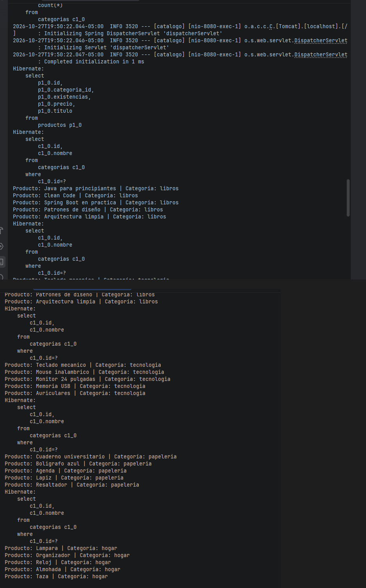

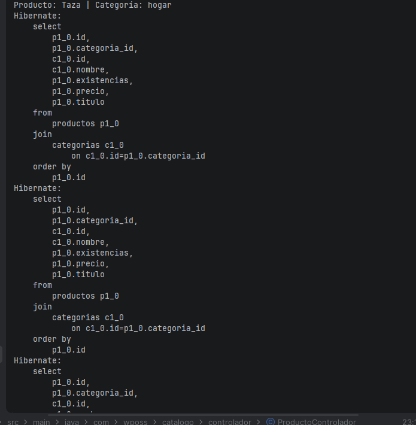

### LazyInitializationException y EntityGraph

Durante las pruebas de `GET /api/productos/1` y `GET /api/productos/sin-stock?limite=5` se observó un error HTTP 500:

```text
Could not initialize proxy [com.wposs.catalogo.modelo.Categoria#2] - no session
```

La relación era `LAZY` y la sesión de Hibernate ya estaba cerrada cuando Jackson intentó acceder a la categoría. Se resolvió con `@EntityGraph(attributePaths = {"categoria"})` en los métodos pertinentes de `ProductoRepositorio`, sin cambiar la relación a `EAGER`. Los endpoints volvieron a devolver correctamente sus respuestas JSON.

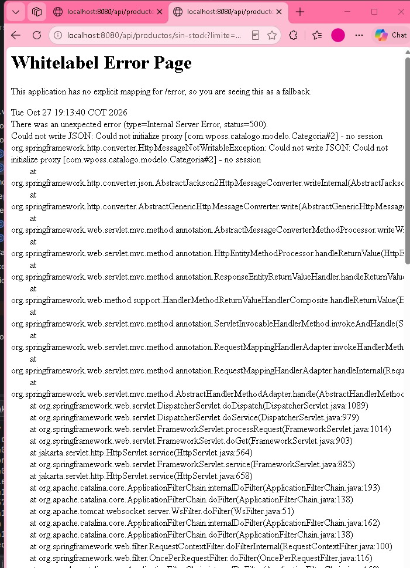

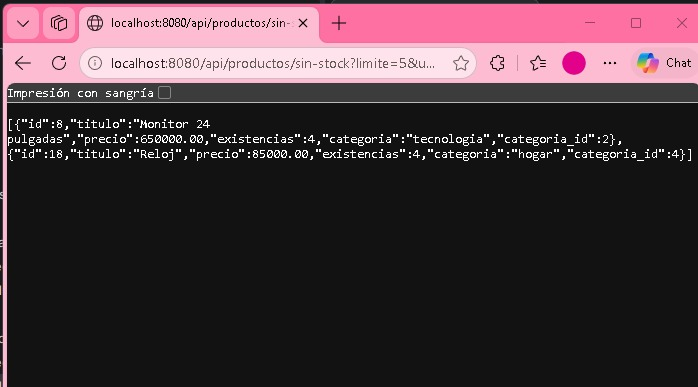

### Dirty checking

`ProductoServicio.cambiarPrecioSinSave()` obtiene un producto dentro de una transacción y modifica su precio sin llamar a `repositorio.save()`. En la demostración histórica, el precio del producto ID 1 cambió de 45.000 a 46.000; los registros de Hibernate mostraron el `UPDATE` al confirmar la transacción. Esto demuestra el dirty checking de una entidad gestionada.

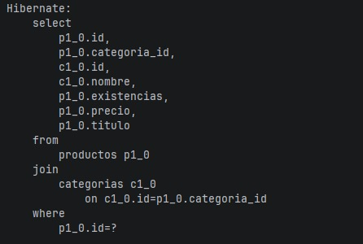

### Evidencia histórica de pruebas

En el taller se documentaron siete pruebas automatizadas exitosas.

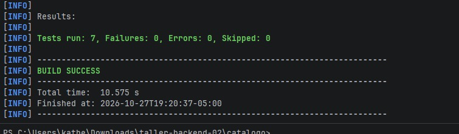

## Backend 03 — DTOs, validaciones y manejo de errores

### DTOs y aislamiento de entidades

Los controladores de productos y categorías intercambian DTOs en lugar de exponer las entidades JPA. `ProductoNuevo`, `ProductoActualizar`, `ProductoResumen` y `ProductoDetalle` mantienen las respuestas desacopladas del modelo persistente.

En una demostración temporal se añadió `costoProveedor` a `Producto` y un endpoint de prueba que devolvía la entidad con el valor `123.45`. Ese endpoint incluyó el campo; la respuesta normal de `GET /api/productos/1`, construida con `ProductoDetalle`, no lo incluyó. Después de la demostración se retiraron el campo y el endpoint temporal. Ningún controlador de la aplicación expone la entidad JPA completa.

### Validaciones y manejo global de excepciones

Los DTOs usan Jakarta Bean Validation para validar campos como título, precio, existencias y categoría. `ManejadorGlobalExcepciones` transforma errores de validación, JSON inválido, recursos inexistentes o duplicados, reglas de negocio y errores inesperados en respuestas estructuradas.

El formato común es `ErrorRespuesta`, con `momento`, `estado`, `error`, `mensaje`, `ruta` y, cuando aplica, `campos`.

### Transacciones y rollback

Las lecturas utilizan `@Transactional(readOnly = true)`. `transferirExistencias` actualiza dos productos dentro de una transacción y lanza una excepción si las existencias del origen quedarían negativas; el cambio completo se revierte.

La demostración automatizada adicional usó un producto de prueba cuyo precio inicial era `10.00`:

- Al cambiarlo a `20.00` y lanzar una excepción checked, la transacción confirmó el cambio.
- Al intentar cambiarlo a `30.00` y lanzar una `RuntimeException`, la transacción revirtió el cambio y el precio permaneció en `20.00`.

La prueba está en `TransaccionesDemostracionTest`; elimina el producto de prueba al terminar.

### Pruebas de API

Las pruebas MockMvc conservadas verifican listado, creación con `Location`, eliminación, estadísticas y filtro por categoría. También verifican precio negativo y `campos.precio`, título en blanco y `campos.titulo`, título demasiado largo, categoría inexistente, título duplicado, producto inexistente con mensaje y ruta, JSON malformado y aislamiento de los campos de categoría en el DTO de detalle.

## Backend 04 — Spring Security y JWT

### Arquitectura y flujo de autenticación

`UsuarioRepositorio` persiste las cuentas en PostgreSQL. `UsuarioDetallesServicio` carga usuarios desde la base de datos, expone sus autoridades y rechaza cuentas desactivadas. `UsuarioServicio` gestiona el registro y la consulta de perfiles. `AuthControlador` ofrece registro, login y el perfil autenticado; `ServicioJwt` genera y valida los tokens; `FiltroJwt` procesa el encabezado Bearer antes de la autorización de Spring Security.

El login delega la autenticación de credenciales a `AuthenticationManager`. En las solicitudes posteriores, el filtro verifica el JWT, vuelve a cargar la cuenta y sus roles desde la base de datos y establece la autenticación de la solicitud. La API no utiliza sesión HTTP para autenticar: `SessionCreationPolicy.STATELESS`.

### Dependencias

El módulo utiliza Spring Boot 3.5.7 y Spring Security 6, `spring-boot-starter-security`, JJWT 0.12.6 (`jjwt-api`, `jjwt-impl` y `jjwt-jackson`) y `spring-security-test`. Java 21 y H2 para pruebas se mantienen.

### Entidad Usuario

`Usuario` contiene `id`, `usuario`, `contrasena`, `correo`, `rol` y `activo`. El nombre de usuario tiene una restricción única en la base de datos. El enum Java `Rol` contiene `ADMIN`, `EDITOR` y `USER`; un conversor persiste las autoridades como `ROLE_ADMIN`, `ROLE_EDITOR` y `ROLE_USER`. Las cuentas nuevas están activas por defecto.

### BCrypt y almacenamiento de contraseñas

El registro codifica la contraseña con `BCryptPasswordEncoder` antes de persistirla. No se guarda ni se devuelve la contraseña en texto plano, su hash ni la entidad `Usuario` completa. No se deben incluir contraseñas o hashes reales en documentación, comandos versionados o registros.

### Registro y login

| Método y ruta | Acceso | Comportamiento |
| --- | --- | --- |
| `POST /api/auth/registro` | Público | Valida y registra la cuenta; devuelve `201` y una respuesta con JWT |
| `POST /api/auth/login` | Público | Autentica con `AuthenticationManager`; devuelve `200` y una respuesta con JWT |
| `GET /api/auth/yo` | Autenticado | Devuelve el perfil público de la cuenta del token |
| `GET /api/usuarios/{usuario}` | ADMIN | Devuelve el perfil público de la cuenta solicitada |

El registro exige usuario, contraseña de al menos ocho caracteres y correo válido. La aplicación asigna siempre el rol `USER`; un campo de rol enviado por el cliente se ignora. Si el usuario está repetido, responde `409`.

El login recibe `usuario` y `contrasena`. Si las credenciales no son válidas, responde `401` con el mensaje genérico exacto `usuario o contraseña incorrectos`, sin revelar cuál dato falló.

Ejemplos estructurales con valores ficticios de marcador (no son credenciales):

```json
{"usuario":"<usuario>","contrasena":"<clave-local>","correo":"<correo-valido>"}
```

```json
{"usuario":"<usuario>","contrasena":"<clave-local>"}
```

La respuesta de autenticación contiene `token`, `tipo` (`Bearer`), `usuario` y `rol`. Los DTOs de perfil solo incluyen información pública.

### JWT

La propiedad `app.jwt.secreto` se resuelve desde `JWT_SECRETO`; no tiene valor predeterminado. El contexto falla al arrancar si falta la variable o el secreto tiene menos de 32 bytes. No se registra ni se incluye un secreto real en el repositorio o en este documento.

Los JWT se firman con HS256, duran exactamente 3600 segundos (una hora) y contienen exclusivamente `sub`, `roles`, `iat` y `exp`. El parser verifica la firma y la expiración al procesarlos. Un token vencido, manipulado o firmado con otra clave no autentica.

### Filtro JWT

`FiltroJwt` extiende `OncePerRequestFilter` y busca el esquema Bearer en el encabezado `Authorization`. Si no hay encabezado o no comienza por `Bearer `, continúa la cadena. Ante un JWT inválido, vencido o manipulado, registra el rechazo en `DEBUG` sin registrar el token y continúa; no genera por sí mismo una respuesta 401. Las rutas públicas siguen funcionando y Spring Security responde en las protegidas. Un encabezado sin el esquema Bearer también continúa la cadena y, en una ruta protegida, Spring Security responde `401` en JSON en lugar de producir un error `500`.

El filtro se agrega a la cadena de Spring Security y no se registra como filtro servlet independiente.

### SecurityFilterChain y autorización por roles

La configuración usa `SecurityFilterChain`, `@EnableMethodSecurity`, `@PreAuthorize`, CSRF desactivado y sesiones stateless. Las comprobaciones con `hasRole("USER")` corresponden a `ROLE_USER`, por lo que `@WithMockUser(roles = "USER")` y `@WithMockUser(roles = "ADMIN")` siguen la misma convención.

| Rutas y métodos | Permiso |
| --- | --- |
| `POST /api/auth/registro`, `POST /api/auth/login` | Público |
| `GET /api/auth/yo` | Autenticado |
| `GET /api/productos/**`, `GET /api/categorias/**` | Público |
| `POST` y `PUT /api/productos/**` | ADMIN o EDITOR |
| `DELETE /api/productos/**` | ADMIN |
| Escrituras `POST`, `PUT`, `PATCH` y `DELETE /api/categorias/**` | ADMIN |
| `/api/usuarios/**` | ADMIN |
| Cualquier otra solicitud | Autenticación requerida |

El servicio de perfiles usa `authentication.name` para permitir que cada usuario consulte su propio perfil; ADMIN puede consultar perfiles de otros usuarios.

Para habilitar un administrador inicial, registra primero una cuenta normal, que tendrá el rol `USER`. Un operador autorizado debe promoverla mediante un procedimiento administrativo restringido sobre PostgreSQL y verificar que se actualice exactamente una cuenta. No existe un endpoint público de asignación de roles. No guardes contraseñas, hashes ni tokens en el procedimiento; registra y audita el cambio y restringe el acceso directo a la base.

### Manejo de errores 401 y 403

`AuthenticationEntryPoint` responde `401` y `AccessDeniedHandler` responde `403`. Ambos devuelven JSON con el formato común `ErrorRespuesta` (`momento`, `estado`, `error`, `mensaje`, `ruta`), no páginas HTML de Tomcat. El 401 usa el mensaje genérico de autenticación; el 403 indica que faltan permisos.

### CORS

`CorsConfigurationSource` lee `app.cors.origenes`, cuyo valor predeterminado es `http://localhost:4200`. Permite los métodos GET, POST, PUT, DELETE y OPTIONS, los encabezados Authorization y Content-Type, y credenciales. CORS está integrado con `SecurityFilterChain` para atender las solicitudes previas OPTIONS.

No se debe combinar `allowedOrigins("*")` con `allowCredentials(true)`: Spring puede rechazar esa configuración y los navegadores no aceptan una respuesta con `Access-Control-Allow-Origin: *` para una solicitud con credenciales. La página puede mostrar un error CORS y JavaScript no podrá leer la respuesta. Configura los orígenes permitidos explícitamente. No se ha realizado ni se afirma una demostración manual de este error y no hay captura del navegador.

### Configuración y ejecución en Windows

En PowerShell, desde la raíz del proyecto, genera un secreto aleatorio para la sesión actual. El ejemplo no imprime el secreto:

```powershell
$bytes = New-Object byte[] 32
$rng = [System.Security.Cryptography.RandomNumberGenerator]::Create()
$rng.GetBytes($bytes)
$rng.Dispose()
$env:JWT_SECRETO = [Convert]::ToBase64String($bytes)
```

Introduce de forma interactiva la contraseña que ya corresponde a la base local. No guardes el valor en el repositorio:

```powershell
$credencialDb = Get-Credential -UserName catalogo -Message "Credenciales locales de PostgreSQL"
$env:DB_PASSWORD = $credencialDb.GetNetworkCredential().Password
```

Inicia la aplicación:

```powershell
.\mvnw.cmd spring-boot:run
```

La aplicación conserva la conexión local `localhost:5433/catalogo`. No cambies ese puerto ni recrees la base o sus volúmenes. Comprueba el mapeo antes de iniciar cualquier contenedor: el `docker-compose.yml` versionado publica actualmente el puerto local 5432, mientras la aplicación espera 5433; reutiliza la configuración existente de `catalogo-db` en 5433 en lugar de asumir que ambos mapeos son intercambiables.

Para modificar los orígenes CORS en la sesión de PowerShell:

```powershell
$env:CORS_ORIGENES = "http://localhost:4200,https://catalogo.example"
```

### Pruebas automatizadas

Ejecuta la suite desde PowerShell:

```powershell
.\mvnw.cmd clean test
```

Las pruebas utilizan H2 en memoria, no requieren que PostgreSQL o Docker estén encendidos y configuran un secreto aleatorio solo durante la ejecución de pruebas. Se conservan las pruebas de los talleres anteriores.

### Demostraciones

#### Demostración 1: token legible — realizada

La captura existente de jwt.io muestra el payload decodificado de la demostración:

```json
{
  "sub": "prueba04-1067643530",
  "roles": ["ROLE_USER"],
  "iat": 1794083622,
  "exp": 1794087222
}
```

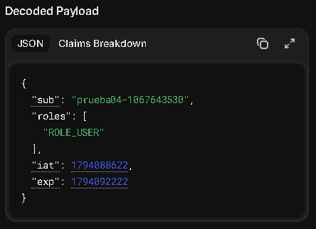

La diferencia entre `exp` e `iat` es 3600 segundos, equivalente a una hora. La firma permite verificar la autenticidad e integridad del token: detecta cambios y verifica que se firmó con la clave correspondiente. La firma no cifra el contenido; los campos del payload son legibles para quien tenga el token.

#### Demostración 2: token manipulado — realizada

En la prueba manual se modificó un carácter del campo `sub` del payload y se conservó la firma original. El servidor rechazó el JWT con HTTP `401 Unauthorized`. Al modificarse el payload, la firma original ya no corresponde al contenido y permite detectar la alteración. La aplicación valida la firma antes de consultar al usuario en la base de datos.

La respuesta fue JSON:

```json
{
  "estado": 401,
  "error": "Unauthorized",
  "mensaje": "usuario o contraseña incorrectos",
  "ruta": "/api/auth/yo",
  "campos": {}
}
```

No existe una captura guardada de esta prueba; por eso se documenta el resultado sin imagen. No se incluye el token manipulado.

#### Demostración 3: token después de cerrar sesión — realizada

La demostración se ejecutó de forma controlada:

1. Se guardó temporalmente en PowerShell una copia del JWT de un usuario `USER` de Backend 04.
2. Se colocó esa copia temporalmente en la clave `wposs_token` del Local Storage de Frontend 05.
3. Se cerró sesión mediante el botón **Cerrar sesión** del frontend.
4. Se comprobó que `wposs_token` y `wposs_usuario` habían desaparecido del Local Storage.
5. Se reutilizó la copia temporal desde PowerShell contra `GET /api/auth/yo`.
6. Backend 04 respondió HTTP `200` con el perfil público del usuario.

Capturas disponibles:

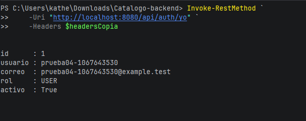

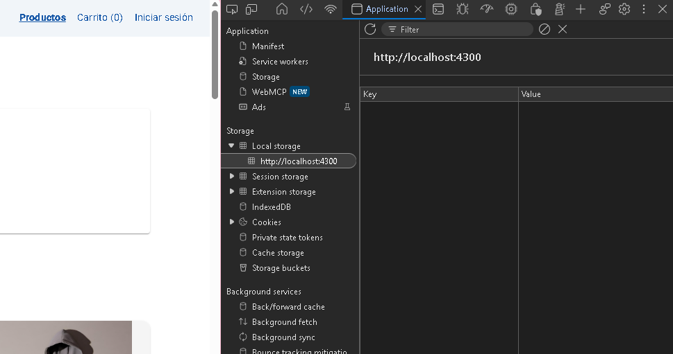

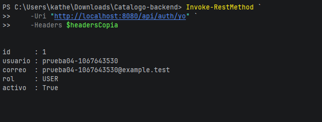

El cierre de sesión de Frontend 05 elimina el token almacenado localmente, pero no puede revocar una copia previamente obtenida. Backend 04 utiliza JWT stateless y no mantiene una lista de revocación, por lo que esa copia todavía se acepta mientras no expire. Esta fue una demostración controlada, no una integración completa: Frontend 05 utiliza actualmente una API externa.

### Demostración CORS — realizada

Para esta prueba se configuró temporalmente `CORS_ORIGENES=*` y se reinició Spring Boot. Desde el Frontend en `http://localhost:4300` se ejecutó una petición `fetch` al Backend con `credentials: 'include'` y el encabezado `Authorization`. El navegador bloqueó la solicitud previa `OPTIONS` y mostró:

```text
Response to preflight request doesn't pass access control check: No 'Access-Control-Allow-Origin' header is present on the requested resource.
GET ... net::ERR_FAILED
TypeError: Failed to fetch
```

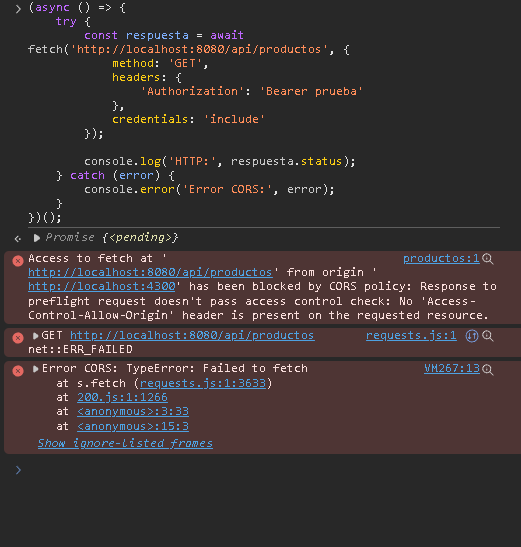

El resultado demuestra que el navegador bloquea la respuesta: `Access-Control-Allow-Origin: *` no se puede combinar con credenciales. La solución es especificar explícitamente los orígenes permitidos. La configuración normal del proyecto no cambia: `CorsConfigurationSource` obtiene los orígenes de `app.cors.origenes` (por defecto, `http://localhost:4200`); el comodín se usó solo durante esta demostración.

Para revocar tokens antes de su expiración se podrían implementar expiraciones más cortas, una lista de revocación consultada por el servidor o refresh tokens rotatorios y revocables. Estas alternativas requieren diseñar y gestionar estado adicional.

## Seguridad y datos

No incluyas en este README ni en el repositorio secretos JWT reales, contraseñas, hashes BCrypt de usuarios reales o tokens vigentes. Los valores entre marcadores en los ejemplos no son credenciales.
