# Catálogo Backend — Talleres Backend 01–05

## Backend 05 — Documentación, perfiles y despliegue

### Descripción y tecnologías

API REST de productos, categorías y usuarios, desarrollada con Java 21 y Spring Boot 3.5.7. Expone operaciones de catálogo y autenticación, con validaciones, transacciones, respuestas JSON de error y autorización por roles.

Utiliza Spring Web, Spring Security, JWT (JJWT), BCrypt, Spring Data JPA, PostgreSQL, Flyway, Springdoc OpenAPI, Actuator y pruebas con H2. Esta versión integra los aprendizajes de los talleres anteriores. El proyecto se empaqueta con Docker y Docker Compose; el frontend es una aplicación Angular 17 desplegada en Vercel, en un repositorio aparte.

### Perfiles y base de datos

`application.properties` aplica `ddl-auto=validate`, Flyway y el puerto `${PORT:8080}`. El perfil predeterminado es `dev`. `application-dev.properties` apunta por defecto a PostgreSQL local en `localhost:5433/catalogo`, muestra SQL y permite Swagger. `application-test.properties` utiliza H2 en memoria, las migraciones reales y datos de prueba; Swagger está desactivado. `application-prod.properties` requiere explícitamente las variables de base de datos y CORS; desactiva Swagger y el SQL detallado. Las contraseñas y el secreto JWT no tienen valores predeterminados.

Flyway aplica, en orden, `V1__esquema_inicial.sql` (categorías y productos), `V2__usuarios_y_roles.sql` y `V3__datos_semilla.sql` (categorías iniciales). El esquema coincide con las entidades actuales; Hibernate valida el esquema, pero no lo crea ni lo actualiza. Los veinte productos de ejemplo se cargan únicamente mediante el `CommandLineRunner` activo en `dev`; las pruebas los preparan desde `src/test/resources/data.sql`.

La configuración de desarrollo local directa mantiene el puerto host `5433`, compatible con la configuración local anterior. Compose publica PostgreSQL en el host como `localhost:5434` (puerto interno `5432`), mientras que la API dentro de Compose se conecta a `postgres:5432` por la red interna. Compose usa un volumen nuevo llamado `catalogo_deploy_pgdata`; no borra ni reutiliza automáticamente el volumen antiguo. Una base existente que no tenga historial Flyway requiere una estrategia de respaldo y adopción/migración revisada antes de apuntarla a la aplicación; no se ejecuta `create` sobre ella.

### Variables de entorno

`DB_URL` es la URL JDBC de PostgreSQL, con formato `jdbc:postgresql://...`; se llama `DB_URL` y no `DATABASE_URL` porque la aplicación espera el prefijo `jdbc:`. `DB_USERNAME` y `DB_PASSWORD` son las credenciales de la base de datos. En producción son obligatorias `DB_URL`, `DB_USERNAME`, `DB_PASSWORD`, `JWT_SECRETO` y `CORS_ORIGENES`; ninguna variable obligatoria tiene un valor por defecto en ese perfil. `JWT_SECRETO` debe contener como mínimo 32 bytes. `PORT` lo proporciona la plataforma o usa 8080 localmente. `.env.ejemplo` contiene valores ficticios para Compose; cópialo a `.env`, reemplaza todos los marcadores y no versionees `.env`.

Para iniciar la API localmente desde PowerShell, configura las variables en la sesión sin escribir secretos en el repositorio ni imprimirlos:

```powershell
$env:SPRING_PROFILES_ACTIVE = "dev"
$env:DB_URL = "jdbc:postgresql://localhost:5433/catalogo"
$env:DB_USERNAME = "catalogo"
$credencialDb = Get-Credential -UserName catalogo -Message "Credencial local de PostgreSQL"
$env:DB_PASSWORD = $credencialDb.GetNetworkCredential().Password
$bytes = New-Object byte[] 32
$rng = [System.Security.Cryptography.RandomNumberGenerator]::Create()
$rng.GetBytes($bytes)
$rng.Dispose()
$env:JWT_SECRETO = [Convert]::ToBase64String($bytes)
$env:CORS_ORIGENES = "http://localhost:4200"
Remove-Variable bytes, rng, credencialDb
.\mvnw.cmd spring-boot:run
```

Las variables establecidas en PowerShell aplican solo a esa sesión. Para probar con PostgreSQL local, confirma que la base está disponible en `localhost:5433`; no reutilices una base de datos con datos sin respaldar y preparar antes su historial Flyway.

### Swagger / OpenAPI

La especificación OpenAPI documenta título, versión, descripción y autenticación mediante token firmado. Controladores y operaciones documentan respuestas, y DTOs de entrada incluyen descripciones y ejemplos ficticios, sin alterar sus anotaciones de validación.

Swagger UI: `http://localhost:8080/swagger-ui/index.html`

OpenAPI JSON: `http://localhost:8080/v3/api-docs`

Ambas rutas son públicas solo en `dev`; en `prod` Swagger UI y `/v3/api-docs` están deshabilitados y sus rutas no se autorizan como públicas.

### Endpoints, respuestas y roles

| Método | Ruta | Respuestas principales | Acceso |
| --- | --- | --- | --- |
| `POST` | `/api/auth/registro` | 201, 400, 409 | Público; asigna `USER` |
| `POST` | `/api/auth/login` | 200, 400, 401 | Público |
| `GET` | `/api/auth/yo` | 200, 401 | JWT válido |
| `GET` | `/api/productos` | 200 | Público; admite `?categoria=` |
| `GET` | `/api/productos/{id}` | 200, 404 | Público |
| `GET` | `/api/productos/estadisticas` | 200 | Público |
| `GET` | `/api/productos/sin-stock?limite=5` | 200, 400 | Público |
| `POST` | `/api/productos` | 201, 400, 401, 403, 409 | `ADMIN`, `EDITOR` |
| `PUT` | `/api/productos/{id}` | 200, 400, 401, 403, 404, 409 | `ADMIN`, `EDITOR` |
| `DELETE` | `/api/productos/{id}` | 204, 401, 403, 404 | `ADMIN` |
| `GET` | `/api/categorias` | 200 | Público |
| `POST` | `/api/categorias` | 201, 400, 401, 403, 409 | `ADMIN` |
| `DELETE` | `/api/categorias/{id}` | 204, 401, 403, 404, 409 | `ADMIN` |
| `GET` | `/api/usuarios/{usuario}` | 200, 401, 403, 404 | `ADMIN` |
| `GET` | `/actuator/health` | 200 | Público (detalle según autorización) |
| `GET` | `/actuator/info` | 200 | Público |

No se exponen otros Actuator endpoints; en particular, `/actuator/env` y `/actuator/heapdump` no están habilitados. Health details/components usan `when-authorized`.

### Docker y Compose

Requiere Docker con Compose. En PowerShell, copia `.env.ejemplo` a `.env`, cambia la contraseña y el secreto ficticios por valores seguros, y configura los orígenes frontend:

```powershell
Copy-Item .env.ejemplo .env
docker compose -f compose.yaml up --build -d
docker compose -f compose.yaml ps
docker compose -f compose.yaml logs -f api
```

Compose inicia PostgreSQL 16 y la API con perfil `prod`; la API espera al healthcheck `pg_isready` y utiliza el host interno `postgres`, no `localhost`. PostgreSQL se publica en el host como `localhost:5434` (puerto interno `5432`), para no interferir con el contenedor independiente que usa `5433`; la API se publica en `localhost:8080`. La base conserva sus datos en el volumen nombrado `catalogo_deploy_pgdata`. Para detener los servicios sin borrar datos: `docker compose -f compose.yaml down`. No uses `down -v` si deseas conservar el volumen.

La comprobación de persistencia confirma que un usuario registrado sigue disponible después de `docker compose down` y `docker compose up`, gracias al volumen nombrado:

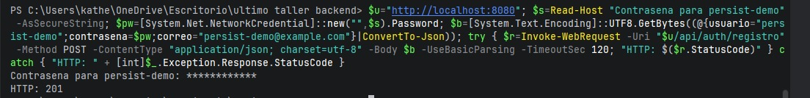

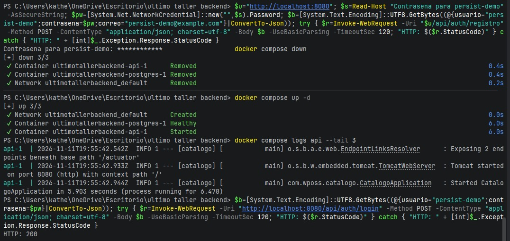

La comprobación de acceso externo se tomó **DESDE OTRA RED**: una persona que no estaba en mi casa abrió `https://catalogo-backend-qnro.onrender.com/api/productos` desde su propio teléfono y su propia conexión, y recibió el listado de productos en JSON. La imagen está recortada para mostrar solo el resultado. Esto comprueba que la API responde desde Internet y no solo desde mi red.

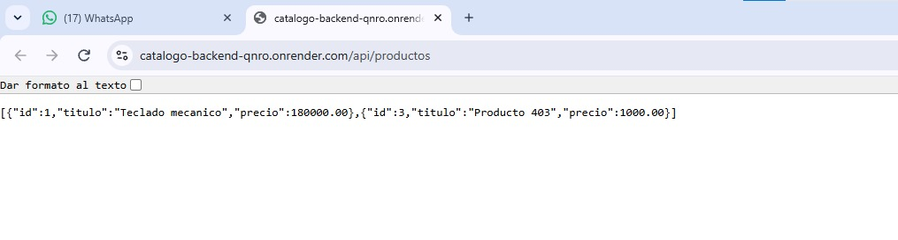

El Dockerfile compila con Maven/JDK 21 y ejecuta el JAR con JRE 21 en la imagen final. El tamaño de la imagen Docker es de 239781840 bytes (aproximadamente 239,8 MB), por debajo del límite de 300 MB.

### Despliegue en Render o plataforma equivalente

El backend está desplegado en Render como `catalogo-backend`: [API](https://catalogo-backend-qnro.onrender.com). La comprobación de salud está disponible en [health](https://catalogo-backend-qnro.onrender.com/actuator/health). La base de datos es PostgreSQL administrada por Render.

#### Despliegue verificado

El servicio aparece en estado Live y el health check informa `UP`:

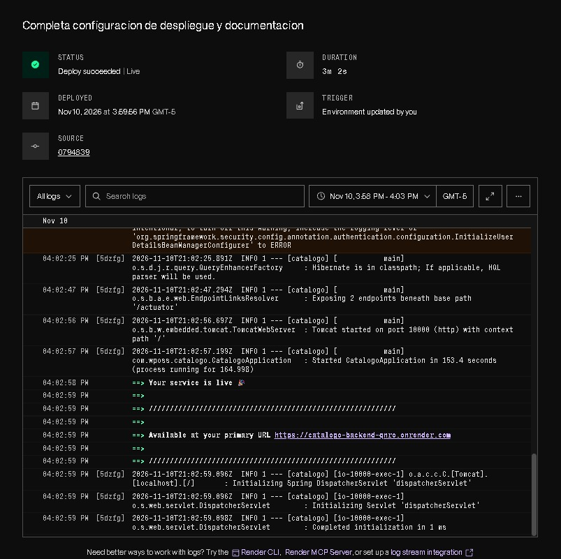

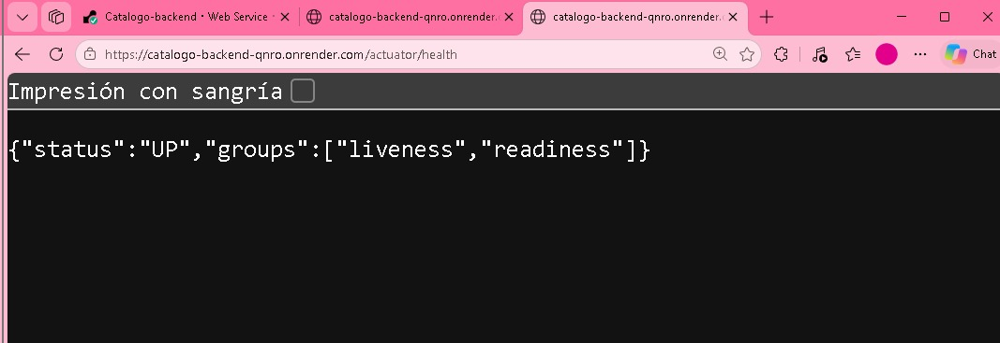

Flyway validó las migraciones y el esquema quedó en la versión 3:

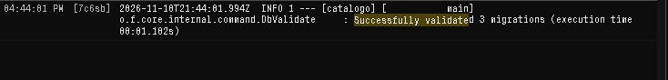

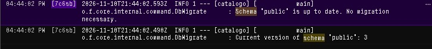

El registro público respondió `201` y asignó el rol `USER`; también se verificaron el login de ese usuario, el login de `ADMIN` y la creación de un producto con token:

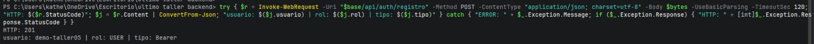

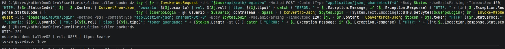

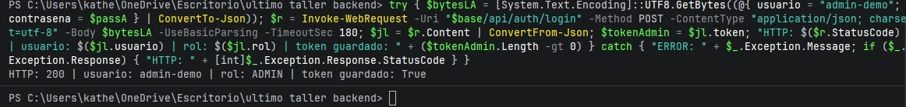

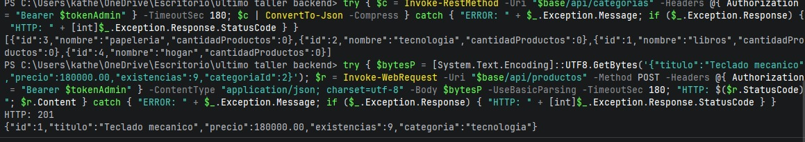

Después de reiniciar el servicio, el producto siguió disponible:

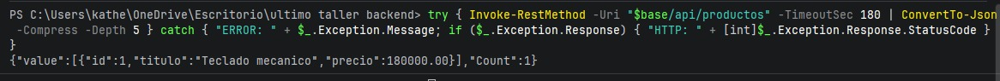

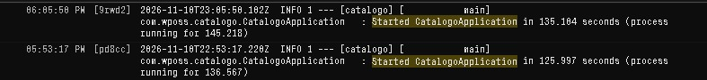

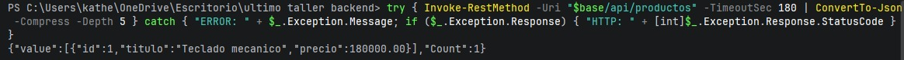

#### Guía de despliegue

1. Crea una base PostgreSQL administrada y conserva sus datos en la plataforma. Usa una base vacía para la primera ejecución de Flyway o prepara antes la migración de cualquier base existente.
2. Crea un servicio web desde la rama `despliegue`, selecciona el Dockerfile del repositorio y configura las variables `SPRING_PROFILES_ACTIVE=prod`, `DB_URL`, `DB_USERNAME`, `DB_PASSWORD`, `JWT_SECRETO` y `CORS_ORIGENES`. La URL JDBC debe usar el hostname interno y puerto que indique el proveedor, en formato `jdbc:postgresql://<host-interno>:<puerto>/<base>`.
3. Genera un `JWT_SECRETO` aleatorio con al menos 32 bytes. Guarda credenciales solo en el gestor de variables de la plataforma. No publiques los valores ni la URL de conexión con credenciales.
4. Deja que la plataforma defina `PORT`; si ofrece una opción de puerto explícita, configura el servicio para que pase esa variable a la aplicación. Spring usa `${PORT:8080}`.
5. Espera al arranque y verifica `/actuator/health`. Una vez asignado el dominio real, agrega el origen exacto del frontend a `CORS_ORIGENES`, separado por comas si son varios.

En producción, Swagger UI y `/v3/api-docs` están intencionalmente deshabilitados.

### Demostraciones del taller

#### 1. Perfil prod sin `JWT_SECRETO` — realizada

Sin configurar `JWT_SECRETO`, la aplicación no arranca y el error indica `Could not resolve placeholder 'JWT_SECRETO'`:

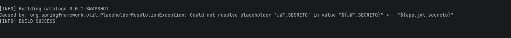

Este comportamiento es preferible a arrancar con un secreto predeterminado: ese secreto sería público y cualquiera podría fabricar tokens válidos y entrar como `ADMIN`.

#### 2. Validación del esquema sin migración — realizada

Al agregar temporalmente el campo `campoSinMigracion` a la entidad `Producto` sin una migración, el arranque falla con `Schema-validation: missing column [campo_sin_migracion] in table [productos]`. Al agregar la migración V4, Flyway la aplica y la aplicación arranca:

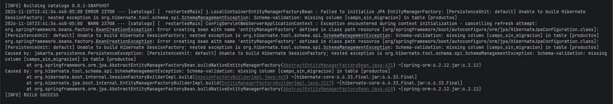

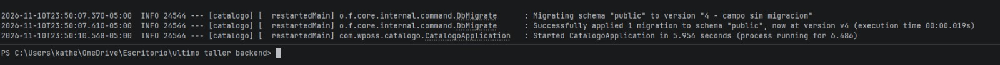

Es preferible a `ddl-auto=update` porque el cambio del esquema queda versionado y revisado, y no se modifica la base en silencio. El campo y la migración V4 fueron temporales, se probaron contra una base local de desarrollo y se revirtieron después.

#### 3. Swagger en dev y rutas deshabilitadas en producción — realizada

En `dev`, `/swagger-ui/index.html` responde correctamente. En producción (Render), con un token válido, `/swagger-ui/index.html`, `/v3/api-docs`, `/actuator/env` y `/actuator/heapdump` devuelven `404`; sin token devuelven `401`, porque la seguridad responde antes de comprobar si la ruta existe.

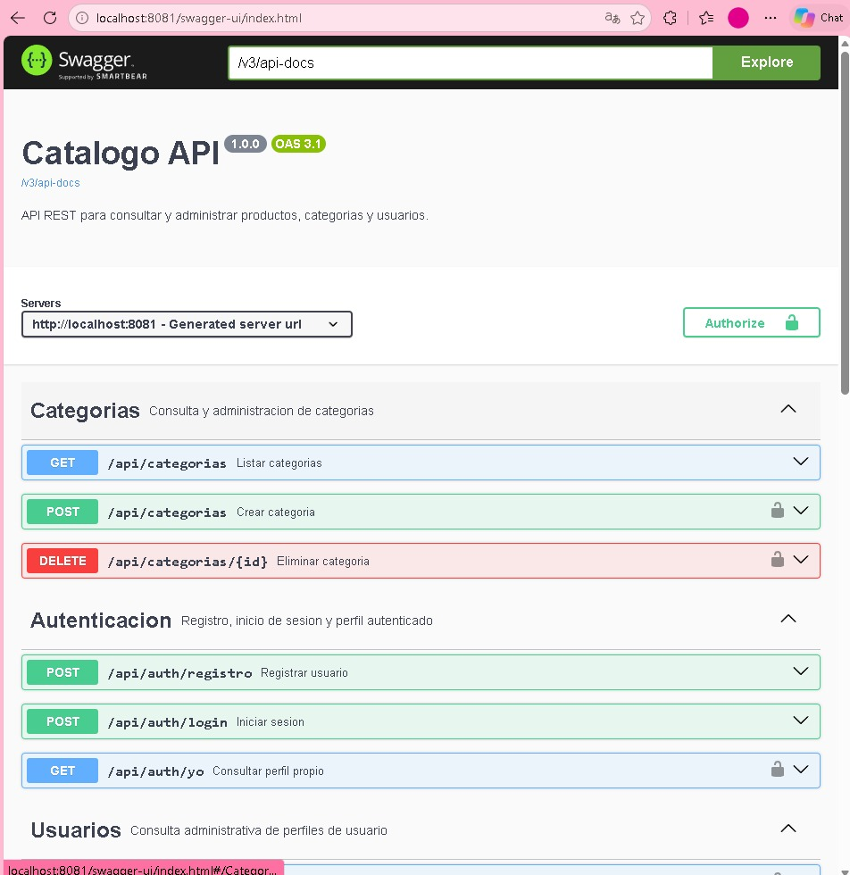

La captura de Swagger en `dev` se tomó con el Compose de desarrollo (`compose.dev.yaml`), que publica la API en el puerto `8081`; con Maven directo, el puerto es `8080`.

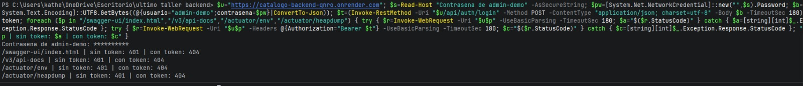

Para que el `404` sea correcto, se agregó un manejador de `NoResourceFoundException` que devuelve `404` en lugar de `500`.

### Integración con Angular y evidencia frontend

El frontend desarrollado con Angular 17 está desplegado en Vercel en https://catalogo-semillero-ebon.vercel.app/ y consume esta API. `CORS_ORIGENES` contiene el dominio de Vercel. El frontend solo exige sesión; es el backend quien decide los permisos: crear y editar exigen ADMIN o EDITOR, y borrar exige ADMIN, por lo que un usuario sin rol ADMIN recibe 403 al intentar borrar. Este repositorio no contiene el código de Angular.

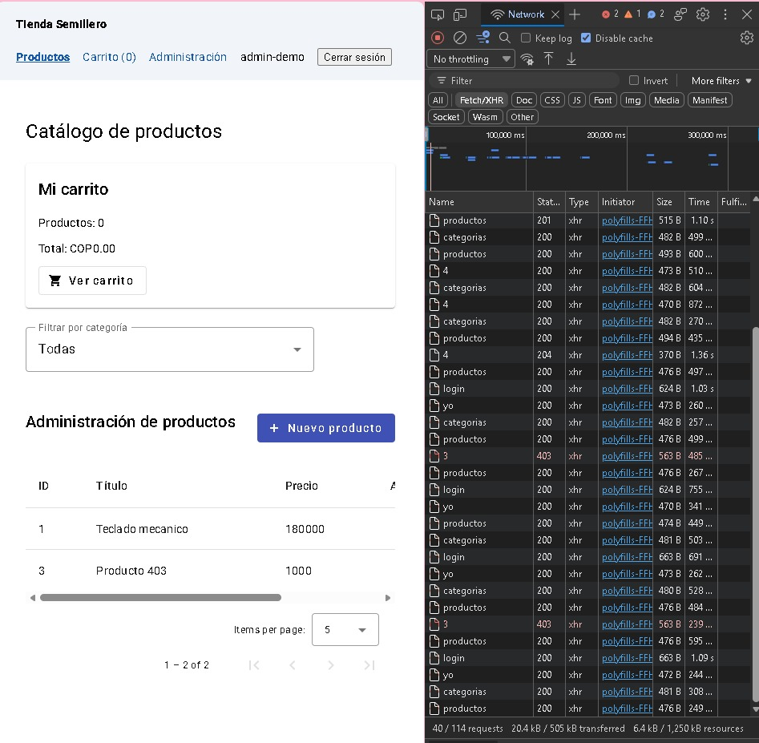

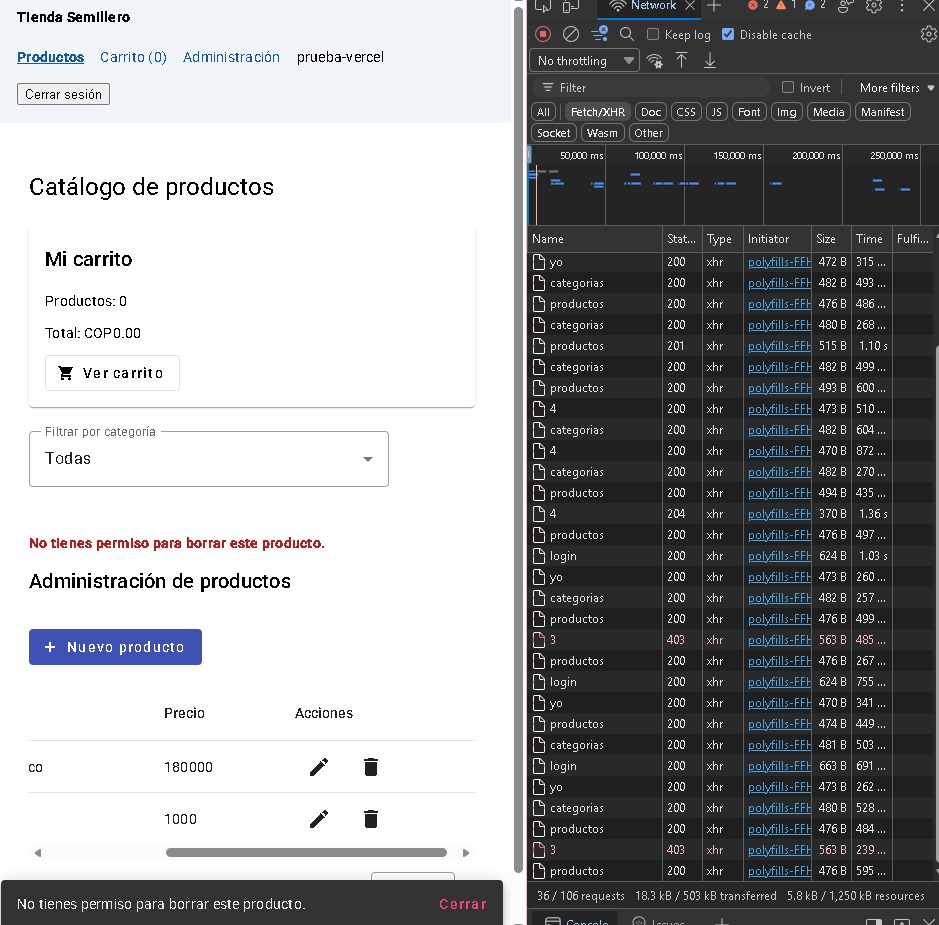

### Compilación y pruebas

```powershell
.\mvnw.cmd clean test
```

Las pruebas usan H2 y datos de prueba cargados solo bajo `test`; no requieren PostgreSQL ni Docker. Para validar únicamente compilación y empaquetado sin ejecutar pruebas, usa `.\mvnw.cmd -DskipTests package`.

## Documentación histórica de Backend 01–04

Proyecto desarrollado progresivamente durante los talleres Backend 01, 02, 03 y 04. La API de catálogo comenzó con operaciones REST y persistencia, y evolucionó para incluir optimización de consultas, DTOs y validación, transacciones, manejo uniforme de errores y autenticación con Spring Security y JWT.

La aplicación utiliza Spring Boot 3.5.7, Java 21, Spring Data JPA, Hibernate y PostgreSQL. Las pruebas automatizadas se ejecutan con H2 en memoria.

## Backend 01 — API REST y catálogo

La API expone operaciones REST para productos y categorías. Los productos pueden consultarse por ID, categoría, existencias y estadísticas; las categorías permiten listar, crear y eliminar, respetando las reglas de negocio.

Rutas principales del catálogo:

| Método | Ruta | Resultado |
| --- | --- | --- |
| `GET` | `/api/productos` | Lista productos; admite `?categoria=libros` |
| `GET` | `/api/productos/{id}` | Consulta un producto |
| `GET` | `/api/productos/estadisticas` | Estadísticas del catálogo |
| `GET` | `/api/productos/sin-stock?limite=5` | Productos bajo el límite de existencias |
| `POST` | `/api/productos` | Crea un producto y devuelve `201` con `Location` |
| `PUT` | `/api/productos/{id}` | Actualiza un producto |
| `DELETE` | `/api/productos/{id}` | Elimina un producto |
| `GET` | `/api/categorias` | Lista categorías |
| `POST` | `/api/categorias` | Crea una categoría |
| `DELETE` | `/api/categorias/{id}` | Elimina una categoría si no tiene productos |

Ejemplo de cuerpo de producto:

```json
{"titulo":"Nuevo","precio":1999.99,"categoriaId":1,"existencias":3}
```

## Backend 02 — JPA, Hibernate y persistencia

### Persistencia con JPA e Hibernate

La aplicación persiste productos y categorías con entidades JPA y repositorios Spring Data. La relación entre `Producto` y `Categoria` se carga de forma diferida (`FetchType.LAZY`). `spring.jpa.open-in-view=false` evita mantener abierta la sesión de persistencia durante la serialización de la respuesta.

### Problema N+1 y solución

Se realizó una demostración con 20 productos distribuidos en cuatro categorías: libros, tecnología, papelería y hogar. Antes de optimizar, `repositorio.findAll()` seguido del acceso a `producto.getCategoria().getNombre()` produjo cinco consultas: una para los productos y cuatro para las categorías. Hibernate reutilizó las categorías ya cargadas en la sesión.

La consulta `buscarConCategoria()` utiliza `JOIN FETCH` para obtener los productos y sus categorías en una sola consulta:

```java
@Query("select p from Producto p join fetch p.categoria order by p.id")
List<Producto> buscarConCategoria();
```

El resultado de la demostración fue reducir las consultas de cinco a una.


### LazyInitializationException y EntityGraph

Durante las pruebas de `GET /api/productos/1` y `GET /api/productos/sin-stock?limite=5` se observó un error HTTP 500:

```text
Could not initialize proxy [com.wposs.catalogo.modelo.Categoria#2] - no session
```

La relación era `LAZY` y la sesión de Hibernate ya estaba cerrada cuando Jackson intentó acceder a la categoría. Se resolvió con `@EntityGraph(attributePaths = {"categoria"})` en los métodos pertinentes de `ProductoRepositorio`, sin cambiar la relación a `EAGER`. Los endpoints volvieron a devolver correctamente sus respuestas JSON.


### Dirty checking

`ProductoServicio.cambiarPrecioSinSave()` obtiene un producto dentro de una transacción y modifica su precio sin llamar a `repositorio.save()`. En la demostración histórica, el precio del producto ID 1 cambió de 45.000 a 46.000; los registros de Hibernate mostraron el `UPDATE` al confirmar la transacción. Esto demuestra el dirty checking de una entidad gestionada.


### Evidencia histórica de pruebas

En el taller se documentaron siete pruebas automatizadas exitosas.


## Backend 03 — DTOs, validaciones y manejo de errores

### DTOs y aislamiento de entidades

Los controladores de productos y categorías intercambian DTOs en lugar de exponer las entidades JPA. `ProductoNuevo`, `ProductoActualizar`, `ProductoResumen` y `ProductoDetalle` mantienen las respuestas desacopladas del modelo persistente.

En una demostración temporal se añadió `costoProveedor` a `Producto` y un endpoint de prueba que devolvía la entidad con el valor `123.45`. Ese endpoint incluyó el campo; la respuesta normal de `GET /api/productos/1`, construida con `ProductoDetalle`, no lo incluyó. Después de la demostración se retiraron el campo y el endpoint temporal. Ningún controlador de la aplicación expone la entidad JPA completa.

### Validaciones y manejo global de excepciones

Los DTOs usan Jakarta Bean Validation para validar campos como título, precio, existencias y categoría. `ManejadorGlobalExcepciones` transforma errores de validación, JSON inválido, recursos inexistentes o duplicados, reglas de negocio y errores inesperados en respuestas estructuradas.

El formato común es `ErrorRespuesta`, con `momento`, `estado`, `error`, `mensaje`, `ruta` y, cuando aplica, `campos`.

### Transacciones y rollback

Las lecturas utilizan `@Transactional(readOnly = true)`. `transferirExistencias` actualiza dos productos dentro de una transacción y lanza una excepción si las existencias del origen quedarían negativas; el cambio completo se revierte.

La demostración automatizada adicional usó un producto de prueba cuyo precio inicial era `10.00`:

- Al cambiarlo a `20.00` y lanzar una excepción checked, la transacción confirmó el cambio.
- Al intentar cambiarlo a `30.00` y lanzar una `RuntimeException`, la transacción revirtió el cambio y el precio permaneció en `20.00`.

La prueba está en `TransaccionesDemostracionTest`; elimina el producto de prueba al terminar.

### Pruebas de API

Las pruebas MockMvc conservadas verifican listado, creación con `Location`, eliminación, estadísticas y filtro por categoría. También verifican precio negativo y `campos.precio`, título en blanco y `campos.titulo`, título demasiado largo, categoría inexistente, título duplicado, producto inexistente con mensaje y ruta, JSON malformado y aislamiento de los campos de categoría en el DTO de detalle.

## Backend 04 — Spring Security y JWT

### Arquitectura y flujo de autenticación

`UsuarioRepositorio` persiste las cuentas en PostgreSQL. `UsuarioDetallesServicio` carga usuarios desde la base de datos, expone sus autoridades y rechaza cuentas desactivadas. `UsuarioServicio` gestiona el registro y la consulta de perfiles. `AuthControlador` ofrece registro, login y el perfil autenticado; `ServicioJwt` genera y valida los tokens; `FiltroJwt` procesa el encabezado Bearer antes de la autorización de Spring Security.

El login delega la autenticación de credenciales a `AuthenticationManager`. En las solicitudes posteriores, el filtro verifica el JWT, vuelve a cargar la cuenta y sus roles desde la base de datos y establece la autenticación de la solicitud. La API no utiliza sesión HTTP para autenticar: `SessionCreationPolicy.STATELESS`.

### Dependencias

El módulo utiliza Spring Boot 3.5.7 y Spring Security 6, `spring-boot-starter-security`, JJWT 0.12.6 (`jjwt-api`, `jjwt-impl` y `jjwt-jackson`) y `spring-security-test`. Java 21 y H2 para pruebas se mantienen.

### Entidad Usuario

`Usuario` contiene `id`, `usuario`, `contrasena`, `correo`, `rol` y `activo`. El nombre de usuario tiene una restricción única en la base de datos. El enum Java `Rol` contiene `ADMIN`, `EDITOR` y `USER`; un conversor persiste las autoridades como `ROLE_ADMIN`, `ROLE_EDITOR` y `ROLE_USER`. Las cuentas nuevas están activas por defecto.

### BCrypt y almacenamiento de contraseñas

El registro codifica la contraseña con `BCryptPasswordEncoder` antes de persistirla. No se guarda ni se devuelve la contraseña en texto plano, su hash ni la entidad `Usuario` completa. No se deben incluir contraseñas o hashes reales en documentación, comandos versionados o registros.

### Registro y login

| Método y ruta | Acceso | Comportamiento |
| --- | --- | --- |
| `POST /api/auth/registro` | Público | Valida y registra la cuenta; devuelve `201` y una respuesta con JWT |
| `POST /api/auth/login` | Público | Autentica con `AuthenticationManager`; devuelve `200` y una respuesta con JWT |
| `GET /api/auth/yo` | Autenticado | Devuelve el perfil público de la cuenta del token |
| `GET /api/usuarios/{usuario}` | ADMIN | Devuelve el perfil público de la cuenta solicitada |

El registro exige usuario, contraseña de al menos ocho caracteres y correo válido. La aplicación asigna siempre el rol `USER`; un campo de rol enviado por el cliente se ignora. Si el usuario está repetido, responde `409`.

El login recibe `usuario` y `contrasena`. Si las credenciales no son válidas, responde `401` con el mensaje genérico exacto `usuario o contraseña incorrectos`, sin revelar cuál dato falló.

Ejemplos estructurales con valores ficticios de marcador (no son credenciales):

```json
{"usuario":"<usuario>","contrasena":"<clave-local>","correo":"<correo-valido>"}
```

```json
{"usuario":"<usuario>","contrasena":"<clave-local>"}
```

La respuesta de autenticación contiene `token`, `tipo` (`Bearer`), `usuario` y `rol`. Los DTOs de perfil solo incluyen información pública.

### JWT

La propiedad `app.jwt.secreto` se resuelve desde `JWT_SECRETO`; no tiene valor predeterminado. El contexto falla al arrancar si falta la variable o el secreto tiene menos de 32 bytes. No se registra ni se incluye un secreto real en el repositorio o en este documento.

Los JWT se firman con HS256, duran exactamente 3600 segundos (una hora) y contienen exclusivamente `sub`, `roles`, `iat` y `exp`. El parser verifica la firma y la expiración al procesarlos. Un token vencido, manipulado o firmado con otra clave no autentica.

### Filtro JWT

`FiltroJwt` extiende `OncePerRequestFilter` y busca el esquema Bearer en el encabezado `Authorization`. Si no hay encabezado o no comienza por `Bearer `, continúa la cadena. Ante un JWT inválido, vencido o manipulado, registra el rechazo en `DEBUG` sin registrar el token y continúa; no genera por sí mismo una respuesta 401. Las rutas públicas siguen funcionando y Spring Security responde en las protegidas. Un encabezado sin el esquema Bearer también continúa la cadena y, en una ruta protegida, Spring Security responde `401` en JSON en lugar de producir un error `500`.

El filtro se agrega a la cadena de Spring Security y no se registra como filtro servlet independiente.

### SecurityFilterChain y autorización por roles

La configuración usa `SecurityFilterChain`, `@EnableMethodSecurity`, `@PreAuthorize`, CSRF desactivado y sesiones stateless. Las comprobaciones con `hasRole("USER")` corresponden a `ROLE_USER`, por lo que `@WithMockUser(roles = "USER")` y `@WithMockUser(roles = "ADMIN")` siguen la misma convención.

| Rutas y métodos | Permiso |
| --- | --- |
| `POST /api/auth/registro`, `POST /api/auth/login` | Público |
| `GET /api/auth/yo` | Autenticado |
| `GET /api/productos/**`, `GET /api/categorias/**` | Público |
| `POST` y `PUT /api/productos/**` | ADMIN o EDITOR |
| `DELETE /api/productos/**` | ADMIN |
| Escrituras `POST`, `PUT`, `PATCH` y `DELETE /api/categorias/**` | ADMIN |
| `/api/usuarios/**` | ADMIN |
| Cualquier otra solicitud | Autenticación requerida |

El servicio de perfiles usa `authentication.name` para permitir que cada usuario consulte su propio perfil; ADMIN puede consultar perfiles de otros usuarios.

Para habilitar un administrador inicial, registra primero una cuenta normal, que tendrá el rol `USER`. Un operador autorizado debe promoverla mediante un procedimiento administrativo restringido sobre PostgreSQL y verificar que se actualice exactamente una cuenta. No existe un endpoint público de asignación de roles. No guardes contraseñas, hashes ni tokens en el procedimiento; registra y audita el cambio y restringe el acceso directo a la base.

### Manejo de errores 401 y 403

`AuthenticationEntryPoint` responde `401` y `AccessDeniedHandler` responde `403`. Ambos devuelven JSON con el formato común `ErrorRespuesta` (`momento`, `estado`, `error`, `mensaje`, `ruta`), no páginas HTML de Tomcat. El 401 usa el mensaje genérico de autenticación; el 403 indica que faltan permisos.

### CORS

`CorsConfigurationSource` lee `app.cors.origenes`, cuyo valor predeterminado es `http://localhost:4200`. Permite los métodos GET, POST, PUT, DELETE y OPTIONS, los encabezados Authorization y Content-Type, y credenciales. CORS está integrado con `SecurityFilterChain` para atender las solicitudes previas OPTIONS.

No se debe combinar `allowedOrigins("*")` con `allowCredentials(true)`: Spring puede rechazar esa configuración y los navegadores no aceptan una respuesta con `Access-Control-Allow-Origin: *` para una solicitud con credenciales. La página puede mostrar un error CORS y JavaScript no podrá leer la respuesta. Configura los orígenes permitidos explícitamente. No se ha realizado ni se afirma una demostración manual de este error y no hay captura del navegador.

### Configuración y ejecución en Windows

En PowerShell, desde la raíz del proyecto, genera un secreto aleatorio para la sesión actual. El ejemplo no imprime el secreto:

```powershell
$bytes = New-Object byte[] 32
$rng = [System.Security.Cryptography.RandomNumberGenerator]::Create()
$rng.GetBytes($bytes)
$rng.Dispose()
$env:JWT_SECRETO = [Convert]::ToBase64String($bytes)
```

Introduce de forma interactiva la contraseña que ya corresponde a la base local. No guardes el valor en el repositorio:

```powershell
$credencialDb = Get-Credential -UserName catalogo -Message "Credenciales locales de PostgreSQL"
$env:DB_PASSWORD = $credencialDb.GetNetworkCredential().Password
```

Inicia la aplicación:

```powershell
.\mvnw.cmd spring-boot:run
```

La configuración local actual de desarrollo mantiene `localhost:5433/catalogo`; el nuevo `compose.yaml` publica PostgreSQL en el host como `localhost:5434` (puerto interno `5432`) y la API en Compose se conecta por el nombre interno `postgres:5432`. El volumen nuevo de Compose es independiente del volumen local previo; revisa la sección de perfiles antes de migrar una base existente.

Para modificar los orígenes CORS en la sesión de PowerShell:

```powershell
$env:CORS_ORIGENES = "http://localhost:4200,https://catalogo.example"
```

### Pruebas automatizadas

Ejecuta la suite desde PowerShell:

```powershell
.\mvnw.cmd clean test
```

Las pruebas utilizan H2 en memoria, no requieren que PostgreSQL o Docker estén encendidos y configuran un secreto aleatorio solo durante la ejecución de pruebas. Se conservan las pruebas de los talleres anteriores.

### Demostraciones

#### Demostración 1: token legible — realizada

La captura existente de jwt.io muestra el payload decodificado de la demostración:

```json
{
  "sub": "prueba04-1067643530",
  "roles": ["ROLE_USER"],
  "iat": 1794083622,
  "exp": 1794087222
}
```


La diferencia entre `exp` e `iat` es 3600 segundos, equivalente a una hora. La firma permite verificar la autenticidad e integridad del token: detecta cambios y verifica que se firmó con la clave correspondiente. La firma no cifra el contenido; los campos del payload son legibles para quien tenga el token.

#### Demostración 2: token manipulado — realizada

En la prueba manual se modificó un carácter del campo `sub` del payload y se conservó la firma original. El servidor rechazó el JWT con HTTP `401 Unauthorized`. Al modificarse el payload, la firma original ya no corresponde al contenido y permite detectar la alteración. La aplicación valida la firma antes de consultar al usuario en la base de datos.

La respuesta fue JSON:

```json
{
  "estado": 401,
  "error": "Unauthorized",
  "mensaje": "usuario o contraseña incorrectos",
  "ruta": "/api/auth/yo",
  "campos": {}
}
```

No existe una captura guardada de esta prueba; por eso se documenta el resultado sin imagen. No se incluye el token manipulado.

#### Demostración 3: token después de cerrar sesión — realizada

La demostración se ejecutó de forma controlada:

1. Se guardó temporalmente en PowerShell una copia del JWT de un usuario `USER` de Backend 04.
2. Se colocó esa copia temporalmente en la clave `wposs_token` del Local Storage de Frontend 05.
3. Se cerró sesión mediante el botón **Cerrar sesión** del frontend.
4. Se comprobó que `wposs_token` y `wposs_usuario` habían desaparecido del Local Storage.
5. Se reutilizó la copia temporal desde PowerShell contra `GET /api/auth/yo`.
6. Backend 04 respondió HTTP `200` con el perfil público del usuario.

Capturas disponibles:


El cierre de sesión de Frontend 05 elimina el token almacenado localmente, pero no puede revocar una copia previamente obtenida. Backend 04 utiliza JWT stateless y no mantiene una lista de revocación, por lo que esa copia todavía se acepta mientras no expire. Esta fue una demostración controlada, no una integración completa: Frontend 05 utiliza actualmente una API externa.

### Demostración CORS — realizada

Para esta prueba se configuró temporalmente `CORS_ORIGENES=*` y se reinició Spring Boot. Desde el Frontend en `http://localhost:4300` se ejecutó una petición `fetch` al Backend con `credentials: 'include'` y el encabezado `Authorization`. El navegador bloqueó la solicitud previa `OPTIONS` y mostró:

```text
Response to preflight request doesn't pass access control check: No 'Access-Control-Allow-Origin' header is present on the requested resource.
GET ... net::ERR_FAILED
TypeError: Failed to fetch
```


El resultado demuestra que el navegador bloquea la respuesta: `Access-Control-Allow-Origin: *` no se puede combinar con credenciales. La solución es especificar explícitamente los orígenes permitidos. La configuración normal del proyecto no cambia: `CorsConfigurationSource` obtiene los orígenes de `app.cors.origenes` (por defecto, `http://localhost:4200`); el comodín se usó solo durante esta demostración.

Para revocar tokens antes de su expiración se podrían implementar expiraciones más cortas, una lista de revocación consultada por el servidor o refresh tokens rotatorios y revocables. Estas alternativas requieren diseñar y gestionar estado adicional.

### Entorno aislado de pruebas (perfil `dev`)

El Compose de desarrollo usa una base y volumen separados (`catalogo_dev_pgdata`), publica PostgreSQL en `5435` y la API en `8081`, y activa el perfil `dev`. No cambia el Compose normal ni sus datos. En PowerShell, copia el ejemplo a `.env.dev` y completa todos los valores vacíos; usa contraseñas aleatorias de al menos 16 bytes (máximo 72 bytes para BCrypt) y un secreto JWT de al menos 32 bytes:

```powershell
Copy-Item .env.dev.example .env.dev
docker compose --env-file .env.dev -f compose.dev.yaml up --build -d
docker compose --env-file .env.dev -f compose.dev.yaml ps
docker compose --env-file .env.dev -f compose.dev.yaml logs api
```

Configura `TEST_ADMIN_USERNAME`, `TEST_ADMIN_PASSWORD`, `TEST_EDITOR_USERNAME` y `TEST_EDITOR_PASSWORD` en `.env.dev`. El inicializador `CuentasPruebaDev` crea las cuentas solo con perfil `dev`, guarda las contraseñas con BCrypt y no cambia cuentas que ya existan; si un nombre ya existe con otro rol o está inactivo, el arranque falla en vez de elevarlo. `DatosIniciales` carga los 20 productos únicamente cuando la tabla de productos de esa base está vacía. Las cuentas nuevas usan correos `@example.test`.

Inicia sesión con `POST http://localhost:8081/api/auth/login` usando las credenciales de ADMIN o EDITOR y configura el JWT como Bearer en Insomnia. Ambos roles pueden crear y actualizar productos; solo ADMIN puede eliminarlos. La cuenta EDITOR debe recibir 403 al intentar borrar. Los datos de prueba persisten en el volumen de desarrollo; para conservarlos, no uses `docker compose down -v`.

## Seguridad y datos

No se incluyó en este README ni en el repositorio secretos JWT reales, contraseñas, hashes BCrypt de usuarios reales o tokens vigentes. Los valores entre marcadores en los ejemplos no son credenciales.
