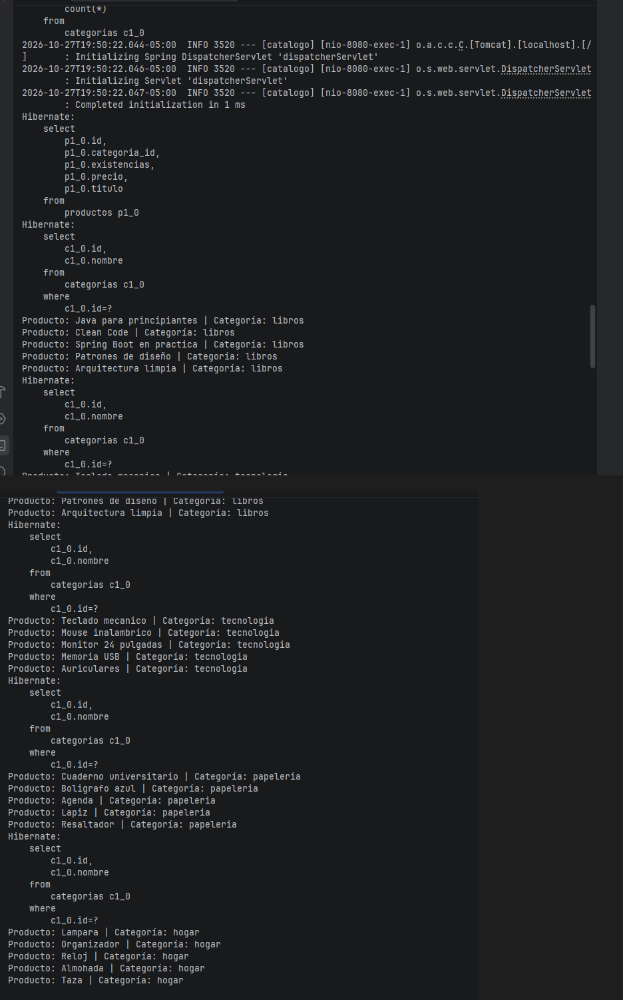
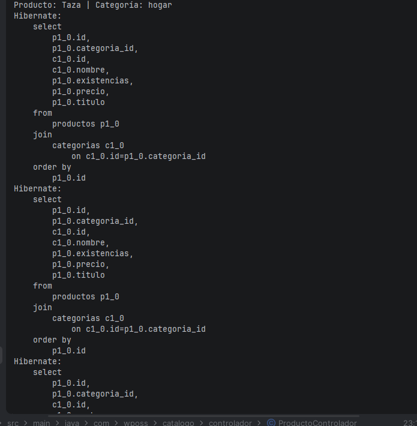
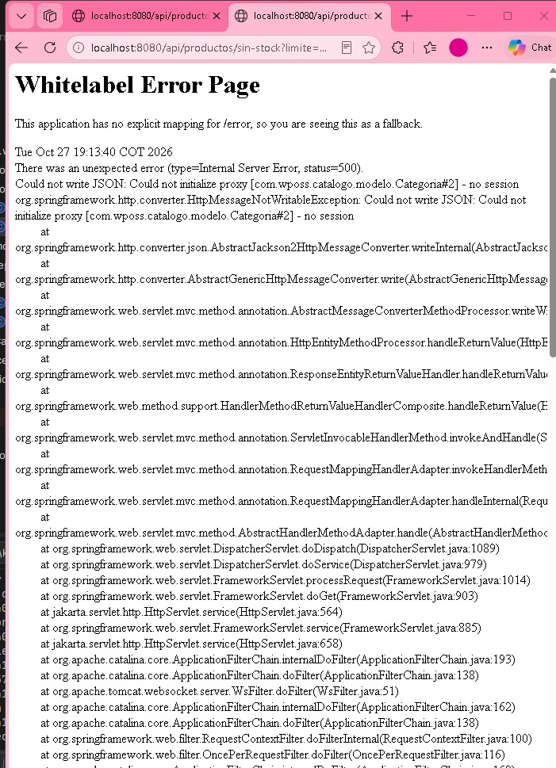
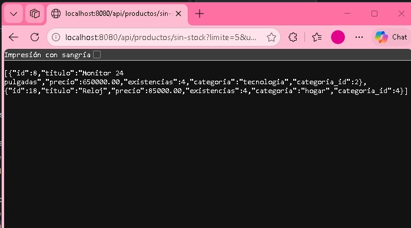
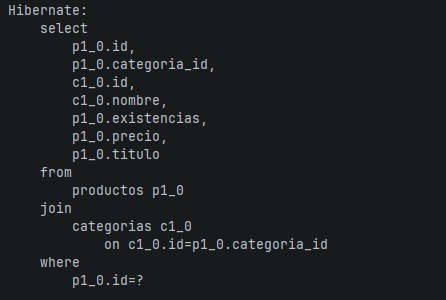
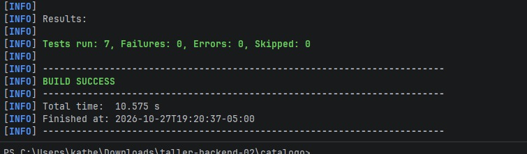

# Taller Backend 02 — Persistencia con JPA y Hibernate

Spring Boot 3.5.7, Java 21, PostgreSQL y H2 para pruebas. Continúa Backend 01.

## Ejecutar

1. Inicia Docker Desktop.
2. `docker compose up -d`
3. En Windows, desde la raíz del repositorio: `.\mvnw.cmd spring-boot:run`
4. Para pruebas sin PostgreSQL: `.\mvnw.cmd clean test` (perfil `test`, H2).

La contraseña se configura con `DB_PASSWORD` (valor local por defecto: `catalogo`). No uses ese valor en producción.

## Endpoints

- GET `/api/productos` (opcional `?categoria=libros`)
- GET `/api/productos/{id}`
- POST `/api/productos` → 201 + Location
- PUT `/api/productos/{id}`
- DELETE `/api/productos/{id}` → 204 o 404
- GET `/api/productos/estadisticas`
- GET `/api/productos/sin-stock?limite=5`
- GET `/api/categorias`
- POST `/api/categorias` → 201 + Location
- DELETE `/api/categorias/{id}` → 204, 404 o 409

Ejemplo JSON producto: `{"titulo":"Nuevo","precio":1999.99,"categoria_id":1,"existencias":3}`. También acepta `"categoria":"libros"` para mantener compatibilidad con Backend 01.

## N+1

**## N+1: problema y solución

Se realizó una demostración utilizando 20 productos distribuidos en cuatro categorías: libros, tecnología, papelería y hogar.

**Antes de la optimización:**

Se utilizó `repositorio.findAll()` y se accedió a `producto.getCategoria().getNombre()` dentro de una transacción.

Hibernate ejecutó cinco consultas SQL:
- Una consulta para recuperar los 20 productos.
- Cuatro consultas adicionales para recuperar las categorías.

Aunque había 20 productos, Hibernate reutilizó las categorías ya cargadas dentro de la misma sesión.

**Después de la optimización:**

Se utilizó el método `buscarConCategoria()` del repositorio:

```java
@Query("select p from Producto p join fetch p.categoria order by p.id")
List<Producto> buscarConCategoria();
```

Hibernate recuperó los productos y sus categorías mediante una sola consulta SQL con `JOIN`.

**Resultado:** las consultas se redujeron de cinco a una, evitando las consultas adicionales asociadas a la carga diferida.

**Evidencias:** capturas de los registros SQL antes y después de utilizar `JOIN FETCH`.

## LazyInitializationException

**## LazyInitializationException

Durante las pruebas de los endpoints `GET /api/productos/1` y `GET /api/productos/sin-stock?limite=5`, se presentó un error HTTP 500.

El mensaje obtenido fue:

```text
Could not initialize proxy [com.wposs.catalogo.modelo.Categoria#2] - no session
```

**Causa:** la relación entre `Producto` y `Categoria` utiliza `FetchType.LAZY`. Como `spring.jpa.open-in-view=false`, la sesión de Hibernate ya estaba cerrada cuando Jackson intentó acceder a la categoría para generar el JSON.

**Solución:** se agregó `@EntityGraph(attributePaths = {"categoria"})` a los métodos correspondientes de `ProductoRepositorio`. Esto permite cargar la categoría junto con el producto, sin modificar la relación a `FetchType.EAGER`.

**Resultado:** ambos endpoints volvieron a funcionar y devolvieron correctamente los datos en formato JSON.

**Evidencias:** Imagenes del error HTTP 500 antes de aplicar la solución y de las respuestas correctas después de corregirlo.

## Dirty checking

## Dirty checking

**Se realizó una prueba para demostrar cómo Hibernate detecta automáticamente los cambios en una entidad gestionada.

En `ProductoServicio.java` se utilizó el método `cambiarPrecioSinSave()`, que obtiene un producto dentro de una transacción y modifica su precio mediante `setPrecio()`, sin llamar a `repositorio.save()`.

**Prueba realizada:**

- Producto utilizado: ID 1.
- Precio anterior: 45.000.
- Precio nuevo: 46.000.
- Resultado: el precio se actualizó correctamente en PostgreSQL.

En los registros de Hibernate se observó una sentencia SQL `UPDATE`, lo que demuestra que el cambio fue detectado y persistido automáticamente al confirmar la transacción.

**Evidencia:** `evidencias/dirty-checking.png`.

## Transacciones

Las lecturas usan `@Transactional(readOnly=true)`. `transferirExistencias` modifica dos productos en una transacción y lanza una excepción si el origen queda negativo; se revierte toda la operación.

## Notas

`ddl-auto=update` es solo para desarrollo. En producción se usarían migraciones versionadas con Flyway o Liquibase.


## Evidencias del Taller Backend 02

### 1. Problema N+1 antes de la optimización

Se observaron cinco consultas SQL para recuperar 20 productos distribuidos en cuatro categorías.



### 2. Solución N+1 con JOIN FETCH

Se utilizó JOIN FETCH para recuperar los productos y sus categorías mediante una sola consulta SQL.



### 3. Error LazyInitializationException

Se presentó un error HTTP 500 porque Hibernate intentó acceder a una categoría después de cerrar la sesión.



### 4. Solución con EntityGraph

Se utilizó EntityGraph para cargar la categoría junto con el producto y solucionar el error.



### 5. Dirty checking

Hibernate actualizó el precio de un producto sin utilizar el método save(), mediante la detección automática de cambios dentro de una transacción.



### 6. Pruebas automatizadas

Se ejecutaron siete pruebas automatizadas correctamente, sin fallos ni errores.

